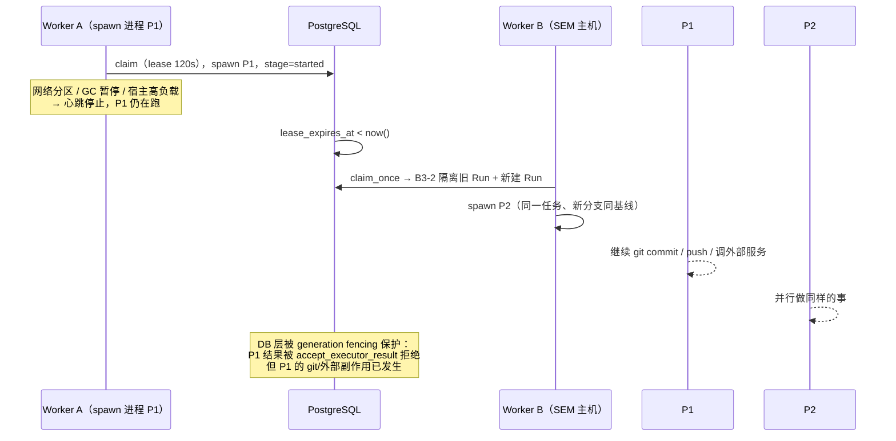
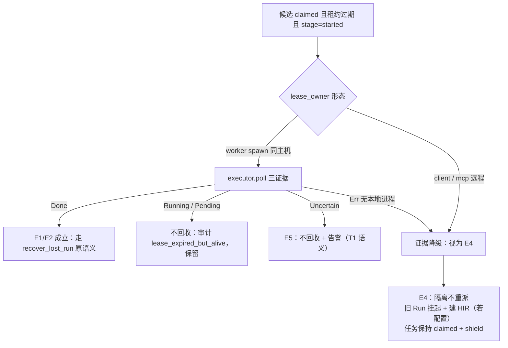

# 执行安全：租约、进程存活与双重执行（execution-safety）

- 性质：架构设计（Phase 0 的设计依据），本阶段不实施。
- 核心公理：**数据库租约状态是「平台认知」，不是「操作系统事实」。租约过期 ≠ 进程死亡。**

## 1. B3-2 双重执行风险：根因

### 1.1 代码事实

回收有两条路径，均**不验证原进程是否已终止**：

| 路径 | 触发条件 | 行为 | 证据 |
|---|---|---|---|
| **P1：claim 回收（B3-2）** | `status='claimed'` 且 `lease_expires_at < now()`，且 `executor_session IS NOT NULL` 且 `stage='started'` | 任务回 ready → `recover_lost_run`：旧 Run 落 `timed_out` + 新建 Run（`attempt_no+1`、`supersedes_run_id`） | `claim.rs:574-674`、`lease.rs:166-202` |
| **P2：B06-D3 孤儿回收** | `status='running'` 且租约过期 >1h，且无 `run.orphan_reclaimed` 审计 | Run 直接 UPDATE 回 `queued`（`termination_reason='lease_expired'`）+ 任务 Running→Blocked→Ready | `run_executor.rs:489-583` |

两条路径都只在 DB 里改状态，**全程无 liveness poll、无进程终止确认**。

### 1.2 语义判定（现状，复核确认）

```
unstarted = executor_session IS NULL OR stage='dispatch'   → B3-1 同 Run 重领（安全）
otherwise（stage='started'）                               → B3-2 隔离 + 新建（危险窗口）
```

`stage='started'` 只证明「曾经成功确认过进程身份」，不证明「进程现在还在/已死」。

### 1.3 双重执行发生序列



### 1.4 七问回答（任务 §三 B）

1. **为什么租约过期会进入回收分支？** 租约是执行权的 TTL。设计意图是「持有者失联 → 执行权可回收再分配」；但当前实现把「租约到期」直接当作「持有者已死」，缺少从 DB 事实到 OS 事实的证据环节。
2. **代码是否验证了原进程已结束？** 否。P1/P2 均无任何进程存活检查。唯一有存活语义的地方是 `reconcile_orphans` 对**租约未过期** Run 的 poll（`run_executor.rs:607`），且 `Uncertain` 时保留不回收（T1 三证据终裁）——这个正确语义**没有被回收路径复用**。
3. **进程存活状态能否通过数据库准确判断？** 不能。DB 只能表达「心跳是否新鲜」（`heartbeat_at` / `lease_expires_at`），心跳新鲜是存活的**必要非充分**信号（心跳停了进程可能还在跑）。进程事实只存在于宿主机（children map、pid 文件、Job Object）或 Runner 自报。
4. **Worker 重启 / 网络断开 / 心跳丢失时分别会发生什么？**
   - *Worker 重启*：内存 children map 丢失；pid 文件与 executor-events.jsonl 在 `AI_PM_WORKSPACE_ROOT` 仍在（当前 compose 未持久化该根 → 重启即失忆）；启动时 `reconcile_orphans` 兜底（`main.rs` 循环 4 启动段）。
   - *Runner 网络断开*：runner 进程活着但心跳停 → P2 在 >1h 后把 Run 回 queued（**无 runner 项目排除**，`run_executor.rs:489-496` 不查 `device_project_binding`）→ 其他领取者可能与原 runner 并行。
   - *心跳丢失（worker 自身 spawn）*：`poll_active_runs` 用本地三证据 poll，能正确判 Running/Dead；但租约过期的 Run 不在 poll 集合里（poll 只扫 `lease_expires_at > now()`，`run_executor.rs:585-594`），而 claim 回收路径不 poll → 证据能力存在却没接到回收决策上。
5. **generation fencing 能防止哪些操作？** DB 写路径全部被守卫：结果接受（`accept_executor_result` 校验 token hash + generation）、Run 状态机迁移（`run_transition_guard`）、命令路由（旧 `lease_owner` 快照失效）、心跳续租（旧 token 不匹配）。旧进程**对 DB 是盲的**。
6. **generation fencing 无法防止哪些外部副作用？** git commit / git push（远端仓库多出未追踪分支提交）、外部服务调用（LLM 消耗、消息发送）、工作区文件写入（P2 与 P1 写同一 worktree 时互相踩）、本地日志/事件文件追加。
7. **旧进程仍运行时能否阻止它 git push / 提交 / 调外部服务？** **不能即时阻断**——它持有的是 OS 层进程与已注入的凭据（git 凭据、SSH key、env 里的 lease token 只影响 DB 通道）。可行的削减手段是：①尽快 terminate（同主机可 kill；Runner 远程通过 WSS 走 cancel 命令 + termination ACK）；②workspace 唯一所有权（P2 不复用 P1 的工作区，新 Attempt 用新 worktree，物理隔离写冲突）；③任务分支隔离（每个执行尝试使用明确的任务分支策略；旧进程 push 的提交仍需检查远端，不得假设 DB generation 能撤销远端写入）；④外部调用面收敛（executor 侧凭据最小化、短时授权、撤销和脱敏，Phase 0 必须覆盖）。

### 1.5 结论

不能靠延长租约掩盖（任务明令禁止）。修复 = 给回收加**终止证据前置** + 给工作区加**唯一所有权**。

## 2. 证据模型（Evidence Model）

回收决策只能基于五类证据，强度递减：

| 级别 | 证据 | 获取方 | 适用形态 | 结论力 |
|---|---|---|---|---|
| E1 | 进程退出码（poll 三证据之一：exit status） | SEM（同主机） | worker spawn | **已死，可回收** |
| E2 | pid 文件存在但 OS 进程不存在（pid + children map 双证） | SEM（同主机） | worker spawn | **已死，可回收** |
| E3 | Runner Supervisor 对精确进程身份的 OS 退出观察并认证上报（自然退出/主动终止/清理/boot transition） | Client Runner | runner spawn | **已死，可回收** |
| E4 | 心跳死亡超过宽限窗（≥ N 个心跳周期，`heartbeat*2 < lease_secs` 已在 runner 侧成立） | DB | runner / mcp | **疑似死亡，只允许隔离，不允许重派** |
| E5 | `Uncertain`（三证据不可确证，T1 语义） | SEM | worker spawn | **疑似存活，保留 + 告警** |

**规则 R-SAFE-1**：重派（新建/回 queued 可再领）只允许在 E1/E2/E3 之上。
**规则 R-SAFE-2**：仅有 E4 时默认只允许隔离、建 HIR，**不允许自动重派**；如需人工风险接受，必须单独走 E6，不能把风险接受写成终止证据。
**规则 R-SAFE-3**：E5 永不回收，沿用 T1 语义。

## 3. 修复设计（Phase 0 内容，两处）

### 3.1 修复点一：claim 回收路径（P1 / B3-2）

`claim_core_in_project` ④ 段在走 `recover_lost_run` 前插入**终止确认步**：



要点：
- poll 在**事务外**执行（不能持行锁等进程证据），因此采用两段式：④ 段发现候选后先跳过该候选（`SKIP LOCKED` 已保证下轮再看），由**循环 4 的 poll_active_runs 扩展集合**（把「租约过期未确认」纳入 poll 对象）完成证据采集并把证据写回 DB（`run_events` 或新审计 action `execution.termination_confirmed`），claim 下一轮读到证据后才走 `recover_lost_run`。
- 代价：回收从「当轮即时」变为「当轮发现、证据到位后下一轮回收」（一个 poll 周期的延迟）。这是用延迟换安全的显式取舍。
- B3-1 分支（unstarted）语义不变。

### 3.2 修复点二：B06-D3 孤儿回收（P2）

- 补 **runner 项目排除**：候选 SQL 加与 `claim.rs:344-380` 同款的 `NOT EXISTS (device_project_binding + is_runner)`——runner 项目的孤儿**不得**走自动回收。
- 补 **证据前置**：>1h 只是告警级别证据（E4）。worker spawn 形态：先 poll 三证据（同 3.1 的证据采集器）；E1/E2 → 现行回收语义保留；E4/E5 → 只落 `run.orphan_suspected` + 挂起，不 UPDATE。
- runner / mcp 形态的孤儿走 **HIR**（见 `runner-supervision-and-handoff.md` §2），由人工决定重派或终止。

### 3.3 E4 持久化 Scheduling Shield

E4 不能只写审计事件或依赖租约续期来维持隔离。必须存在 Platform PostgreSQL 持久化的调度屏障，Platform API 内的所有自动领取与自动回收入口共同检查：

- Run 进入 E4 时，在同一事务中写入 shield 状态/关联 HIR，并使其不再满足普通 claim 候选条件。
- shield 生效期间，lease expiry、B06-D3、orphan reconciliation、普通 retry/requeue 均不得将 Run 放回可领取队列。
- 不通过无限续租伪装执行健康；租约可以自然过期，但 shield 必须独立于租约有效。
- 迟到心跳只更新可观察性，不自动清除 shield，也不自动恢复旧执行权。
- 解除 shield 只有两条路径：①取得 E1/E2/E3 终止证据后，由受控事务执行终态化/重派；②经授权人工处置并明确记录外部副作用风险。任何解除都须检查当前 generation、token 和活动执行者，并写审计。
- shield 是调度安全约束，不等同于 Run 业务终态；HIR 是处置工作流，两者关联但不可互相替代。

### 3.4 凭据与外部副作用安全（Phase 0 必须覆盖）

Generation Fencing 不能撤销已经注入进程的 Git/SSH/API 凭据。Phase 0 必须明确并验证：

- 凭据按 Run/Repository/所需操作最小授权，优先短时、可撤销凭据；不得向通用 Harness 注入长期高权限个人凭据。
- 终止确认前，不能声称旧进程已失去其进程内凭据；需要撤销时记录撤销对象、时间和结果。
- SSH 临时文件使用受限权限、RAII 清理；环境变量和命令行不得泄露 secret；日志、事件、错误信息统一脱敏。
- 若某凭据无法即时撤销，E4/E5 必须视为仍可能产生外部副作用；HIR 处置需检查远端分支/外部系统，不得只依赖 DB fencing。
- Phase 0 验收增加凭据泄露扫描、权限范围检查、撤销演练和旧进程副作用场景。

### 3.5 Greenfield 落地形态（可直接重构，不留兼容层）

- `recover_lost_run` 增加参数 `evidence: TerminationEvidence`（enum：ExitObserved / ProcessGone / RunnerAck），无证据的调用点编译期即失败——直接改签名，不保留「无证据也可回收」的旧入口。
- 证据采集器作为 `RunExecutor` 端口新方法（`confirm_termination(&ExecutorSession) -> TerminationEvidence`），mock/noop 实现返回 `Uncertain`。

## 4. 七要素对照（任务 §三 B 方案要求）

| 要素 | 本方案落点 |
|---|---|
| Process Liveness | 三证据 poll（exit status / pid 文件 / children map），仅同主机有效 |
| Runner Heartbeat | `heartbeat*2 < lease_secs` 已成立（`runner_loop.rs:71-75`）；心跳死亡 = E4 弱证据，只隔离不重派 |
| Lease Expiration | 仍是回收的**触发器**，不再是回收的**依据** |
| Generation / Fencing | 保持现状（DB 写全防护）；证据链是 fencing 之外的进程层补充，两者正交 |
| Process Termination Confirmation | 新增 `confirm_termination` 端口 + 证据落库；重派以证据为前提 |
| Workspace Ownership | 见 §5：一区一进程，新 Attempt 不复用未确认死亡的工作区 |
| External Side Effects | fencing 盲区如实承认；用尽快 terminate + 分支隔离 + HIR 人工兜底削减，不做虚假承诺 |

## 5. 工作区唯一所有权（Workspace Ownership）

- **所有权锚点**：现有 `executor_session`（`{kind}:{uuid}`，spawn 前写入）即工作区归属声明；workspace 目录按 run_id 组织（`workspace_root_from_env()` + run id）。
- **规则**：一个 `task_run` id 的工作区在同一时刻至多一个活进程。`recover_lost_run` 新建的 Run（新 id）**永远拿新工作区**，不继承旧目录路径——旧工作区进入「待清算」状态，由 workspace reclamation 按证据处置（E1/E2 已死 → 可清；E4/E5 → 保留到 HIR 关闭）。
- **跨 Runner 接管时**：原 runner 的工作区在用户设备上，平台不直接触碰；新 runner 领取后按现有 workspace.rs 语义在本地自建/校验工作区（见 `runner-supervision-and-handoff.md` §4）。
- **清理安全**：现有 reclamation 三重开关（`AI_PM_WORKSPACE_RECLAMATION_ENABLED` + `SHARED_ROOT` + 绝对路径）语义保留；新增约束：清理器删除前调用 `confirm_termination`，E4/E5 工作区跳过。

## 6. 风险与遗留

- poll 证据只覆盖 SEM 同主机进程；远程 runner 的进程事实永远依赖 runner 自报（E3）或心跳（E4）——这是分布式边界，不是实现缺陷。
- 「旧进程被 fencing 拒绝后仍可能继续跑完外部副作用」：Phase 0 后残余风险 = E4 窗口内的 git push/外部调用。接受残余并在 HIR 处置时人工核查远端分支。


## 7. 2026-11-25 评审问题修正（规范性补充，优先于前文冲突表述）

### 7.1 E3 不再等同于 cancel ACK

E3 是对精确进程身份的 OS 退出观察，不是命令投递回执。Runner 必须报告自然退出、命令终止、租约丢失后的本地清理、启动孤儿清理、Runner shutdown 和 boot transition reconciliation。报告通过 Runner 设备身份认证的 WSS 连接发送，必须绑定 Run、Generation、boot_id、PID、process creation identity、退出结果、时间和 evidence digest。证据先写入 Runner 本地持久 spool，SEM 持久化 ACK 后才可清除待发记录。Lease 失效不能阻止 Runner 报告旧进程退出事实，但旧 Generation 证据不得修改新 Generation 的业务状态。

命令 receipt ACK、command result 和 E3 process-exit evidence 分开建模。自然退出也必须报告；仅写日志后丢弃 active 不满足 E3。

### 7.2 Lost / Workspace 丢失一律不能作为死亡证明

`ExitOutcome::Lost` 表示无法确定退出状态，不表示已观察到进程退出。若 Platform 已记录 `stage='started'` 或 spawn-confirmed，PID、logs、Workspace root 同时缺失时必须是 `Uncertain/E5`。只有权威记录证明从未 spawn，才可按 B3-1 未启动回收。卷丢失是证据丢失，不是进程死亡。

### 7.3 E6 Human Risk Acceptance

原 R-SAFE-1 只约束**自动重派**：自动重派必须具备 E1/E2/E3。E4/E5 默认隔离，不自动重派。

新增 E6 = Human Risk Acceptance，是有权限操作者明确接受旧进程仍可能运行的风险授权，不是终止证据。E6 可以授权一个唯一、明确绑定的 successor Attempt，但旧 Execution Barrier 仍为 `risk_accepted_unconfirmed`，不得伪装为 released/terminated。必须展示残余风险（重复 Git/外部 API/LLM 副作用）、执行二次确认、记录缓解措施与审计；新 Attempt 使用独立 Workspace/Worktree，外部副作用须人工核查。后续取得 E1/E2/E3 后，才可独立释放旧 Barrier。HIR 关闭和 E6 授权均不自动释放 Barrier。

### 7.4 Interaction、HIR 与屏障的边界

- Interaction shield 保持 `none/human_wait/start_wait/timed_out` 四值，不加入 Detached。
- `Detached` 是 Execution/Session lifecycle 状态；物理隔离由独立 `delivery.run_execution_barrier` 承载。
- Phase 0 必须建立正式 Barrier + 最小可操作 HIR + 收件人/通知投递模型；这需要 Migration，不得再描述为“Phase 0 无 Schema 变更”。
- Interaction terminate/continue、HIR、Continuation、Cleanup Need 分别处理进程控制、执行异常处置、回复注入和资源清理，不互相替代。

### 7.5 统一派发门禁

所有普通 queued claim、B3-1/B3-2、B06-D3、retry/requeue、orphan reconciliation、handoff 和 E6 successor 必须调用统一 Platform dispatchability predicate。普通新启动必须满足 Interaction shield = none 且不存在阻断性 Execution Barrier；Continuation 必须匹配 responded Interaction、start_wait、有效 delivery/command 和当前 generation。B06-D3 不得把 shielded Run 改回可普通领取的 queued 状态。候选 SQL 过滤之后仍须在锁内再次校验。

### 7.6 本节对应完整修正设计

见 [SEM-02D 评审问题核验与修正设计](./sem-02d-review-findings-corrective-design.md)。本节与前文任何“E4 授权重派”“Done{Lost} 可回收”“HIR 到 Phase 4 才可操作”的冲突表述，以本节和修正设计为准；所有内容仍为 Review Pending，未授权实施。
