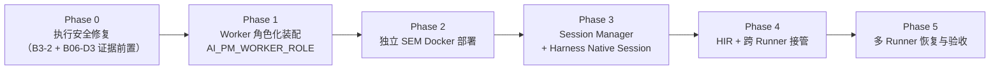

# 迁移路线图：Phase 0–5（migration-roadmap）

- 性质：架构设计（实施计划定稿），本阶段不实施。
- Greenfield 前提（`engineering-lifecycle-policy.md`）：Phase 序号是**架构实施阶段**，不是「必须保留旧架构」的约束；允许直接重构 Schema/接口；每个 Phase 后全新库必须可完整初始化；**Phase 0 不做数据迁移**（无历史生产数据，活跃中的开发库按项目惯例处理）。

## 设计冻结前置说明

D-01–D-12 的完整候选设计已一次性提交，统一等待用户评审；评审入口为 `sem-02d-review-package.md`，详细设计见 `sem-02d-closure-design-proposal.md`。提交设计不代表批准实施。Phase 0 必须等待 D-01/D-02 及相关安全门槛获得用户批准；Phase 1 必须等待 D-03–D-08 的服务协议、SEM DDL 和 Ports/Adapters 契约获得批准。

## 总览

依赖关系是硬序：没有 Phase 0 的证据模型，Phase 2 的独立主机会放大双重执行风险；没有 Phase 1 的角色化，Phase 2 没有可部署单元。

---

## Phase 0：执行安全修复与凭据边界收敛

| 项 | 内容 |
|---|---|
| **前置条件** | 用户 ratify `sem-02d-closure-design-proposal.md` 中 D-01/D-02，并冻结执行安全屏障、最小 HIR 和证据 API 契约后；可在当前单机先行落地 |
| **涉及模块** | `pm-application::run_dispatch`（claim 回收分支）、`pm-application::run_executor`（poll 集合扩展、B06-D3、reconcile_orphans）、`pm-infrastructure::codex_executor`（`confirm_termination` 实现）、Platform 执行安全状态/HIR 最小持久化与审计 |
| **预计修改文件** | 上述执行代码 + 一次 Platform migration（执行安全屏障/HIR 最小记录的正式载体由 SEM-02D 冻结）；`pm-api` 仅在需要暴露安全处置入口时增加最小 API。Phase 0 先确保 E4/E5 有可操作 HIR；Runner E3 远程证据通道在 Phase 1 WSS 完成后启用，之前不得自动重派 |
| **风险** | 回收延迟一个 poll 周期（安全换延迟，接受）；Phase 0 期间远程 Runner 若尚无 E3 通道则进入 E4/E5，但必须由 Phase 0 HIR Inbox 通知并可操作；Phase 1 WSS 上线后才允许使用 Runner E3 自动恢复 |
| **测试** | ①claim 回收：有 E1/E2 证据才 `recover_lost_run`；无证据进入可操作 HIR；②B06-D3 与 queued claim 统一检查 shield/barrier；③Lost/卷丢失→E5；④Interaction terminate/continue 在 Runner 与 CodexExecutor 两种执行位置闭环；⑤HIR 通知/收件人/处置；⑥generation fencing；⑦凭据最小权限、撤销和日志脱敏；⑧q10 系列 |
| **验收标准** | 构造「进程活着 + 租约过期」场景：任何路径都不产生第二个进程；构造「进程死了 + 证据在」场景：下一轮回收成功；全新库迁移链可完整初始化 |
| **回滚方式** | 还原上述文件并按 Greenfield 策略重整 Migration；Barrier/HIR/通知收件人属于正式 Schema 变更，不得回退成无屏障的旧派发行为 |

## Phase 1：Worker 角色化装配与 Platform–SEM API 解耦

| 项 | 内容 |
|---|---|
| **前置条件** | Phase 0 合并；用户 ratify D-03–D-08，Platform–SEM/Runner HTTPS 与 WSS wire contract、认证、SEM schema、Ports/Adapters 边界已冻结 |
| **涉及模块** | `apps/ai-pm-worker` 装配层、Platform/SEM 服务 API、服务身份与各自数据库 |
| **预计修改文件** | `apps/ai-pm-worker/src/main.rs`（角色解析 + 循环 4 拆分；SEM 执行角色通过 Platform HTTPS API 请求 claim 和状态迁移，不再使用 Platform DB 连接）；`apps/pm-api` 内部服务 API；Platform Transactional Outbox 投递；SEM 幂等 Inbox 与独立数据库迁移/配置 |
| **风险** | API 契约遗漏、重复投递、跨服务部分成功；通过幂等键、Inbox、超时重试和对账处理；SEM 误持 Platform DB 凭据必须在部署验收中禁止 |
| **测试** | 三角色启动冒烟；Outbox 重复/延迟/失败投递；SEM 重启后 Inbox 去重与 API 对账；Platform API 不可达；SEM 不含 Platform DB 凭据；claim 并发与 generation fencing；`all` 开发态回归 |
| **验收标准** | `role=platform` 保持业务权威；`role=execution` 不装配 Platform outbox handler、不连接 Platform DB，所有 Run/Lease/Generation 写入均经 Platform API；Outbox/API 故障可恢复且无重复执行 |
| **回滚方式** | 按角色装配、API adapter、应用层 ports 分别回滚；不得回滚到 SEM 访问 Platform DB 的形态。

## Phase 2：独立 Docker 部署（运行期持久卷，不做 Workspace 备份）

| 项 | 内容 |
|---|---|
| **前置条件** | Phase 0/1 合并；Platform HTTPS API 可达；SEM 独立数据库已初始化；workspace 运行期持久卷规划完成；明确不建设 Workspace/Worktree/Git Mirror 备份 |
| **涉及模块** | Dockerfile、infrastructure compose |
| **预计修改文件** | `Dockerfile`（新 execution target：含 codex CLI 的 runtime 层）、`infrastructure/full-dev/docker-compose.ai-pm.yml` 或新 compose 文件（`ai-pm-execution-worker` 服务：`AI_PM_WORKER_ROLE=execution`、`AI_PM_RUN_EXECUTOR=codex`、`AI_PM_WORKSPACE_ROOT` 持久卷、`AI_PM_RUN_DISPATCH=on`；Platform 侧服务设 `AI_PM_WORKER_ROLE=platform` + `AI_PM_RUN_DISPATCH=off`）、部署清单文档 |
| **风险** | SEM 主机到 Platform HTTPS API 或 SEM 自有数据库网络不通；服务身份/证书配置错误；卷权限/UID 错配 |
| **测试** | 全新环境分别初始化 Platform DB 与 SEM DB → Platform + SEM 起服务 → HTTPS Outbox/Inbox 派发 → 端到端跑一条 delivery Run（spawn/poll/收尾）；SEM 容器强杀重启 → Inbox 去重/对账恢复、在途 Run 按证据分类处置；Platform API 短暂不可达后恢复 |
| **验收标准** | 独立主机上真实执行一条任务全链路成功；Platform 主机上无任何执行进程残留；凭据不落卷（审计抽查卷内文件无 token/密钥）；Workspace/Worktree/Git Mirror 无备份依赖，卷丢失进入 E4/E5 安全隔离 |
| **回滚方式** | compose 退回单机 `role=all` 形态（默认形态始终保留） |

## Phase 3：Session Manager

| 项 | 内容 |
|---|---|
| **前置条件** | Phase 2 部署基线稳定 |
| **涉及模块** | `pm-application::session_manager`（新模块）、`pm-infrastructure::codex_executor`、一次迁移 |
| **预计修改文件** | `crates/pm-application/src/session_manager/{mod,ports,lifecycle}.rs`（新）、`crates/pm-infrastructure/src/codex_executor.rs`（SessionProbe/Resume 实现 + harness_session_id 采集）、迁移 `00XX_task_run_harness_session.sql`（`harness_session_id`/`harness_kind` 两列，Greenfield 允许直接改）、`apps/ai-pm-worker/src/main.rs`（投影重建接入启动序列） |
| **风险** | harness 事件格式不稳定（采集失败只降级为不可 resume，不阻塞执行）；Resume 能力未经 codex 实测（默认 false，交付时以实测为准） |
| **测试** | 生命周期状态机纯函数单测；采集→落库→投影重建端到端；重启后 Detached 分类正确；resume=false harness 走新 Attempt |
| **验收标准** | 同一 Run 重启后 Session 投影与执行主机事实一致；Native Session ID 在实际执行主机采集（Runner 设备或 SEM 主机）；`supports_resume=false` 时无任何 Native Resume 尝试 |
| **回滚方式** | 删模块 + 回退迁移（Greenfield：迁移历史允许重整为 clean baseline） |

## Phase 4：Advanced HIR / Cross-Runner Handoff / E6

| 项 | 内容 |
|---|---|
| **前置条件** | Phase 0 最小 HIR/通知/Barrier 已可操作 + Phase 1 E3/Detached 对账 + Phase 3 Session continuity |
| **涉及模块** | Phase 0 已创建的 `governance.human_intervention_request` 的扩展（不重复建表）、`pm-application`（HIR 域服务）、`pm-api`（HIR 查询/处置 REST）、runner（通知/选择交互） |
| **预计修改文件** | 扩展 Phase 0 已可操作的 HIR（高级 Runner 选择、supervised 通知门、E6 风险接受、handoff 记录；不得把基础收件人/通知/处置再次延后）、`crates/pm-application/src/hir/…`（新）、`apps/pm-api/src/…`（路由）、`apps/ai-pm-runner/src/…`（领取前通知门 + 终止 ACK）、前端告警面（提示 Q3 频次） |
| **风险** | runner 交互改动（有人监督模式）影响现有自动领取路径（需模式开关：supervised = 领取前确认；unattended（默认）= 自动领取、失败建 HIR，二选一按部署配置） |
| **测试** | HIR 状态机全迁移路径；接管七不变式逐条集成测试（重点：② token 失效、⑤ 单执行权、⑧ 审计完整）；E4/E5 → HIR；安全重派必须有 E1/E2/E3，风险接受重派必须有 E6 且旧 Barrier 保持未证实 |
| **验收标准** | 构造双 Runner 接管场景：全程无双重执行、无身份校验放宽、审计链完整可回放；Q3 高频只提示不改策略 |
| **回滚方式** | 关闭 HIR 触发开关（E4 行为退化为「永久挂起 + 告警」，安全但需人工 DB 介入）→ 删迁移 |

## Phase 5：多 Runner 恢复与验收

| 项 | 内容 |
|---|---|
| **前置条件** | Phase 0–4 全部合并 |
| **涉及模块** | 无新代码（验收阶段）；测试与演练脚本 |
| **预计修改文件** | 测试文件（集成/混沌场景）、运维演练手册文档 |
| **风险** | 真实设备环境差异（Windows/macOS 进程行为）；演练发现的问题回灌 Phase 0–4 修复 |
| **测试** | ①跨 Runner handoff 全链路（真实两设备）；②SEM 主机断电重启恢复；③Runner 断网 2×lease 时长再重连（resume 路径）；④DB 短暂不可达期间 SEM 行为；⑤并行 10 Run 压测下无双重执行（审计断言） |
| **验收标准** | 演练矩阵全绿；每个故障场景的审计链能完整还原事件时序 |
| **回滚方式** | 不适用（验收阶段；问题按所属 Phase 回修） |

---

## 全局回滚原则

- 每个 Phase 独立可回滚（文件清单见各表）；Greenfield 允许迁移历史重整，回滚不需要向前兼容垫片。
- 执行安全（Phase 0）一经合并不建议回退——它是后续所有 Phase 的安全地平线；若必须回退，回退到的行为必须保留「E4 挂起不重派」底线。

## 批量设计评审门槛（2026-11-25）

- D-01–D-12：完整设计已提交，Review Pending；不再逐项中断等待确认，统一由用户评审后记录 Ratified / Revised / Rejected。
- D-13：已批准 ADR-SEM-26。
- D-12：Phase 0 任何凭据相关代码改动前，必须完成当前 Harness 启动链路的只读凭据注入/继承/泄漏面盘点。
- Phase 0：Not Started。设计评审通过不自动启动实施；仍需用户明确授权开始实施。

## 12. 评审问题修正后的阶段约束（规范性覆盖，Review Pending）

本节覆盖前文 Phase 表中“HIR 到 Phase 4 才可操作”“Runner 重启平台侧无需变更”“Phase 2 只验收普通 Run”等不完整表述。详细方案见 [SEM-02D 评审问题核验与修正设计](./sem-02d-review-findings-corrective-design.md)。

### Phase 0 — Safety + Minimum Human Intervention

Phase 0 不再是“只修 B3-2/B06-D3”。它必须同时交付：
- 正式 Execution Barrier Migration、最小 HIR Migration、通知收件人/投递模型；
- HIR 最小可操作闭环：创建、查询、责任人、通知、证据追加、hold/安全处置、审计；
- 统一 dispatchability predicate，覆盖普通 queued claim、B3-1/B3-2、B06-D3、retry/requeue、orphan reconciliation；
- `Done{Lost}` 卷丢失误判修复，started Run 证据缺失进入 E5；
- Execution Control Port：Runner 与 SEM-local CodexExecutor 都有明确 terminate/continue/reply-injection 消费者；
- Interaction created 即时通知，不能只写 Audit；120 秒是 response deadline，不是通知等待。

Phase 0 必须有 Migration；“无 Schema 变更”不适用于正式 Barrier/HIR/通知收件人模型。Phase 0 未实施前，E4/E5 只能安全隔离，不能假装已具备人工处置闭环。

### Phase 1 — SEM Control Plane + Runner E3 + Detached Recovery

- 建立 Platform–SEM HTTPS、Runner–SEM WSS、Ticket 与连接 epoch。
- Runner process evidence spool + 自然退出/主动终止/租约丢失清理/启动清理/重启对账上报。
- 建立 Detached → Reconciling → Active/Terminated/Quarantined。
- 迁移后删除 Runner MCP Claim/command poll/ACK/recovery 控制旁路；Harness MCP 仅保留业务通道。

### Phase 2 — 独立部署 + Full Interaction Acceptance

部署验收必须包含普通任务、Interaction terminate → 用户回复 → continue → checkpoint/reply 注入 → consumed、HIR 通知/处置、E3、Runner 重启/网络分区、资源准入和 SEM 重启。不能只以一条普通 delivery Run 成功作为验收完成。

### Phase 3 — Session Continuity

Session Manager 只做跨执行位置生命周期仲裁。Native Session ID 在真实 Harness 执行主机采集；SEM 不读取远端 Runner 的 CODEX_HOME。Process Reattachment、Interaction Continuation、Harness Native Resume 三种能力分开验收；Native Resume 默认关闭。

### Phase 4 — Advanced HIR / Cross-Runner Handoff / E6

Phase 4 扩展跨 Runner 选择、supervised 通知和 E6 Human Risk Acceptance，不再首次创建 HIR、首次做通知或首次提供人工处置入口。E6 是风险授权，不是终止证据；旧 Barrier 保持未证实状态。

### Phase 5 — Multi-Runner Chaos Acceptance

增加 E3 spool 重放、boot transition、E5 卷丢失、E6 单次 successor、Interaction 双执行位置、通知无收件人/死信、shielded queued Run 等测试。
