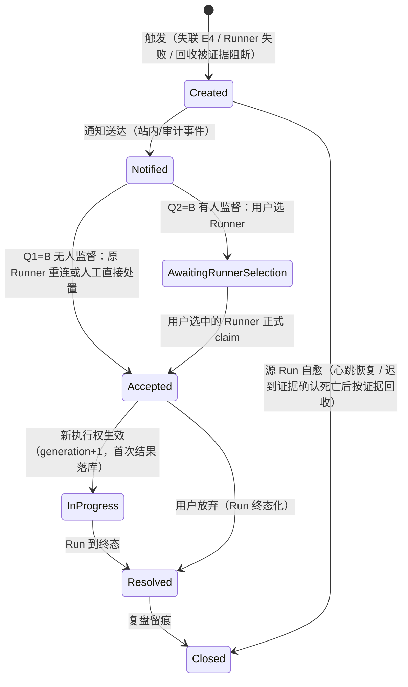
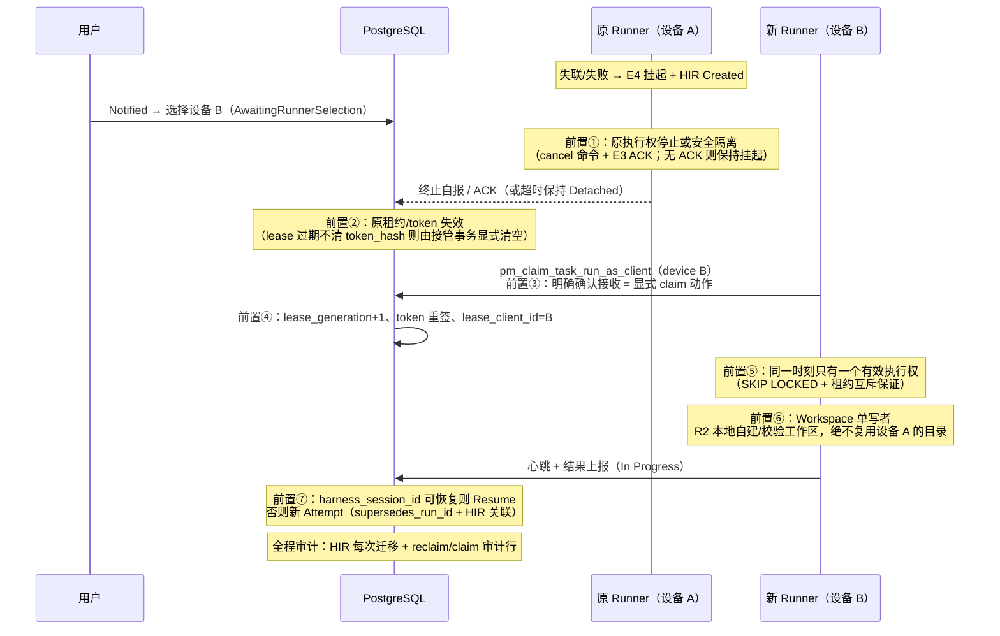

# Runner 监督模式、HIR 与跨 Runner 接管（runner-supervision-and-handoff）

- 性质：架构设计（Phase 4/5 的设计依据），本阶段不实施。
- 已确认决策：**Q1=B、Q2=B、Q3=A**（见 §2）。

## 1. 三类执行主体的监督边界

| 主体 | 监督者 | 进程归属 | 平台可见性 |
|---|---|---|---|
| SEM（worker spawn） | Session Manager + CodexExecutor（同主机） | SEM 宿主机进程 | pid 文件 / children map / 三证据 poll |
| Client Runner（有人监督） | 用户（人) | 用户设备进程 | 租约/心跳/命令通道/自报 |
| Client Runner（无人监督） | SEM + Runner Supervisor | 用户设备进程 | WSS heartbeat + generation-bound process-exit evidence；失联且无证据走 E4/E5 + HIR |

**默认监督模式**：Runner 注册缺省为 `unattended`；只有明确配置 `supervised` 才走领取前用户确认。监督模式与在线/忙碌状态正交。

**硬规则**：Server Worker **不得**把 Client Runner 当本地子进程管理——`executor.poll`/`terminate` 对远程 session 只能返回 Err/Uncertain（现状即如此，`run_executor.rs:607-609`），SEM 侧终止确认对 runner 形态走 **E3（Runner 终止 ACK）**，见 `execution-safety.md` §2。

## 2. 三项已确认决策

| # | 决策 | 落地含义 |
|---|---|---|
| Q1=B | **无人监督** Runner 失败后 → 创建 HIR，**尽可能恢复原 Session** | 失败/失联 ≠ 立即重派；先建 HIR，恢复判定按 `session-manager-design.md` §4.3 |
| Q2=B | **有人监督** Runner 接任务前 → 通知用户选 Runner；**用户选择 ≠ 接管成功** | 选择只是授权意图；接管完成以「新 Runner 正式 claim 成功（generation+1）」为准 |
| Q3=A | 高频人工介入 → **只提示，不自动改策略** | HIR 频次超阈值 → 提醒面告警；不自动降级/换 Runner/改任务策略 |

## 3. Human Intervention Request（HIR）生命周期

- **HIR 载体（已定稿）**：采用独立表 `governance.human_intervention_request`。HIR 是具有独立 ID、状态、触发原因、责任主体、时间戳和审计历史的业务实体；审计事件只记录变更，不代替 HIR 当前状态。HIR 不替代 `delivery.task_interaction`。
- HIR 与 Run 的关联：`task_run_id` + 触发证据类型（E3/E4/E5）+ `harness_session_id`（可恢复时）。
- **HIR 是 Phase 0 证据模型的兜底**：E4/E5 挂起的 Run 必须有出路，HIR 就是那条出路。

## 4. 跨 Runner 接管安全模型

### 4.1 接管全序列（安全不变式内嵌）

### 4.2 七条安全不变式（任务 §六 checklist 逐条落位）

| 不变式 | 机制 |
|---|---|
| ① 原执行端停止或安全隔离 | cancel 命令 + E3 终止确认；无 E3 → Run 保持 Detached（scheduling shield），**不进入接管** |
| ② 原租约/token/generation 失效 | 接管 claim 事务内显式清 `lease_token_hash` + generation+1（现有 claim ⑨ 段已做 generation+1，补显式 token 失效步） |
| ③ 新 Runner 明确确认接收 | Q2=B 的「用户选择」只是授权；接管以 `claim_task_run_as_client`（设备 B 显式 claim）为准 |
| ④ 新 generation 生效 | 现有 `lease_generation = COALESCE+1`（`claim.rs:928-963`），不动 |
| ⑤ 同一时刻一个有效执行权 | 现有 `FOR UPDATE SKIP LOCKED` + 单活跃 Run 约束，不动 |
| ⑥ Workspace 不被双写 | Runner 工作区本就是设备本地目录（`workspace.rs`），新 Runner 永远用自己设备的工作区；平台侧 SEM 工作区按 run_id 唯一（`execution-safety.md` §5） |
| ⑦ Session 恢复优先、否则新 Attempt 并关联 | `session-manager-design.md` §4.3 判定树 + HIR 关联字段 |
| ⑧ 全程可审计 | HIR 状态迁移审计 + 现有 claim/reclaim 审计，无新增旁路 |

### 4.3 不放宽 `lease_client_id`（任务硬约束）

- 接管**不修改**任何身份校验：`lease_client_id = device_id` 的复合外键约束（`fk_task_run_client_tenant`）、claim 时的身份验证全部原样。
- 「接管」在协议上是**新设备的一次全新合法 claim**——旧执行权自然过期/被证据终止，新执行权走正门。没有任何代码路径「把 A 的租约改绑给 B」。
- 若未来出现「预授权转移」需求（把 claim 权指定给设备 B），必须以新迁移+新校验实现，不走放宽路线（另立 ADR）。

## 5. Runner 监督模式与任务接收通知

### 5.1 默认值与配置

- **默认 `supervision_mode=unattended`**。注册请求未提供该字段时，服务端持久化默认值为 `unattended`。
- 只有用户/管理员明确设置 `supervised` 才启用有人监督流程；不得把缺省、未知值或配置读取失败解释为 supervised。
- 监督模式是 Runner 注册/运行属性，与 online/offline/busy/unavailable 状态正交；心跳不能证明用户在设备旁。
- 模式修改必须经过有权限的用户操作并审计；变更不追溯改变已领取 Run 的监督语义，建议在该 Runner 下一次空闲且未持有租约时生效。

### 5.2 有人监督 Runner 的任务接收通知（Q2=B）

- SEM 是唯一调度与派发入口。仅当目标 Runner 明确配置为 `supervised` 时，SEM 在请求 Platform Claim **之前**通知用户并收集目标 Runner 选择/确认；用户选择只是授权意图，不是 Claim，也不授予执行权。
- `unattended` 是默认模式，SEM 可按 Platform 授权策略自动选择候选 Runner。
- 用户确认后由 SEM 代表目标 Runner 请求 Platform Claim。Platform 必须独立校验目标 device identity、项目绑定、授权和可执行性；Claim 成功后 SEM 才能通过该 Runner 的 WSS 连接派发。
- Runner 不再主动调用 Platform MCP Claim，也不再自行轮询命令/恢复控制接口。Platform 只接受来自受认证 SEM 服务身份的控制面请求；Harness 业务 MCP 不受影响。
- Q3=A：HIR 高频项目只产出提示事件（审计/告警面），**不**自动 shield、不自动换 Runner、不自动改 retry 策略。

## 6. 无人监督 Runner 失败的处置流（Q1=B）

1. 心跳死亡进入 E4 → Run 挂起（`execution-safety.md` R-SAFE-2）→ HIR Created。
2. 优先恢复判定（`session-manager-design.md` §4.3）：原 Runner 重连且 harness 可 resume → 恢复原 Session。
3. 不可恢复 → 用户（或值班流程）通过 HIR 选择 hold、基于 E1/E2/E3 安全重派，或显式 E6 风险接受（只授权一个 successor，旧 Barrier 仍未证实终止）。
4. E4/E5 全程不自动重派；只有 E1/E2/E3 可自动安全重派。E6 是独立人工风险授权，不等于进程终止证据。

## 7. Runner 控制面唯一入口（ADR-SEM-20）

SEM 负责 Runner 注册后的在线连接管理、候选选择、通知、派发、命令路由、执行监督和接管协调。Runner 只与 SEM 建立 WSS 控制连接；不得并行维护 Platform MCP 控制轮询。

- Claim：SEM → Platform HTTPS Claim API（包含目标 Runner 身份），Platform 原子签发 Lease/Generation。
- Lease Renewal：唯一正式路径为 Runner Supervisor → SEM WSS → Platform HTTPS API（ADR-SEM-21）；Platform 是唯一校验和提交方。WSS liveness 与 Harness Agent Activity 均不续租。
- Command/Cancel/ACK/E3：经 WSS；Platform 保留命令业务状态，SEM 仅保存投递账本。
- 业务上下文、Agent Activity、Interaction、结果/交付：Harness → Platform MCP。
- 接管：SEM 协调停止/隔离旧执行端，等待 E3 或按 E4/E5 保持 shield/HIR；随后通过 Platform 正常 Claim 流程为目标 Runner 申请新 Generation。不得改写 lease owner 或绕过 `lease_client_id`。

## 8. 同机多任务的资源准入（ADR-SEM-26 — Approved）

Runner Supervisor 通过 WSS 定期上报 CPU、内存和 Workspace 实际所在磁盘卷的容量/可用空间。SEM 结合最新资源快照、任务资源画像、现有活动任务和原子资源预留，决定同一台 PC 是否还能接收新任务。资源报告不是 Heartbeat、Lease Renewal 或进程退出证据。资源样本过期/未知时停止新派发，但不杀死现有任务、不释放其预留；内存或磁盘硬阈值不足时拒绝新任务。V1 不自动暂停、终止或迁移运行中的任务。该设计已由 ADR-SEM-26 正式冻结。

## 9. 评审问题修正：Runner 进程证据与 Detached 恢复（Review Pending）

### 9.1 进程退出证据必须主动上报

当前 Runner 自然退出路径会记录日志并清空 active；租约丢失清理路径会本地终止并记录 cleanup evidence。目标协议必须将这些路径变成持久化进程证据：自然退出、terminate 命令、lease-loss cleanup、startup orphan cleanup、shutdown 和 boot transition。Runner 先写本地 evidence spool，再经 WSS 上报 `runner.process.exit` / `runner.process.reconciled`；Lease 过期不能阻止追加旧 Generation 的进程观察。命令 ACK 不能替代 E3。

### 9.2 Runner 重启不只是 Interaction start_wait 恢复

当前 `recovery.rs` 的续领路径要求 `scheduling_shield='start_wait'` 且存在 responded Interaction；它只覆盖“人工已回复、continue 待消费”，不覆盖执行中途失联。目标状态必须包含 `Active → Detached → Reconciling → Active/Terminated/Quarantined`。同设备恢复需重新认证、boot/process identity 对账、当前 Lease/Generation 校验；不满足则 E4/E5 + Barrier + HIR。

### 9.3 E6 与接管不变式

原七条不变式中“原执行端停止或安全隔离”需要区分两种路径：
- **正常接管**：E1/E2/E3 证明旧进程终止，才释放旧 Barrier 并进入正常 Claim。
- **E6 风险接受接管**：旧进程仍可能运行；由有权限操作者二次确认并接受残余风险，只能授权一个绑定 successor。旧 Barrier 保持 `risk_accepted_unconfirmed`，不宣称旧执行端已停止。必须独立 Workspace、尽可能撤销凭据、检查 Git/外部副作用并完整审计。

E6 不是 E3，不可写成 terminate ACK，也不可解除旧 Barrier。没有 E6 时，E4/E5 不允许重派。

## 10. Interaction / HIR / Cleanup 映射

- Interaction：Agent 提问与用户回复；由执行端 terminate，再由 continue 注入回复。
- Continuation：回复 delivery/checkpoint 注入与新 Agent Session 启动。
- HIR：执行异常、失联、风险接受、跨 Runner 接管的治理流程；Phase 0 已有最小可操作 Inbox，Phase 4 仅扩展高级 handoff。
- Cleanup Need：Workspace/进程清理人工处理；若同时存在进程不确定性才关联 HIR/Barrier。
- Execution Barrier：Run+Generation 的执行隔离事实。
- Interaction scheduling_shield：保持原四值，不新增 Detached。

HIR 与 Interaction 可以互相引用，但 HIR 关闭、Continuation consumed、Cleanup completed 都不能自动释放 Execution Barrier。

完整修正见 [评审问题核验与修正设计](./sem-02d-review-findings-corrective-design.md)。
