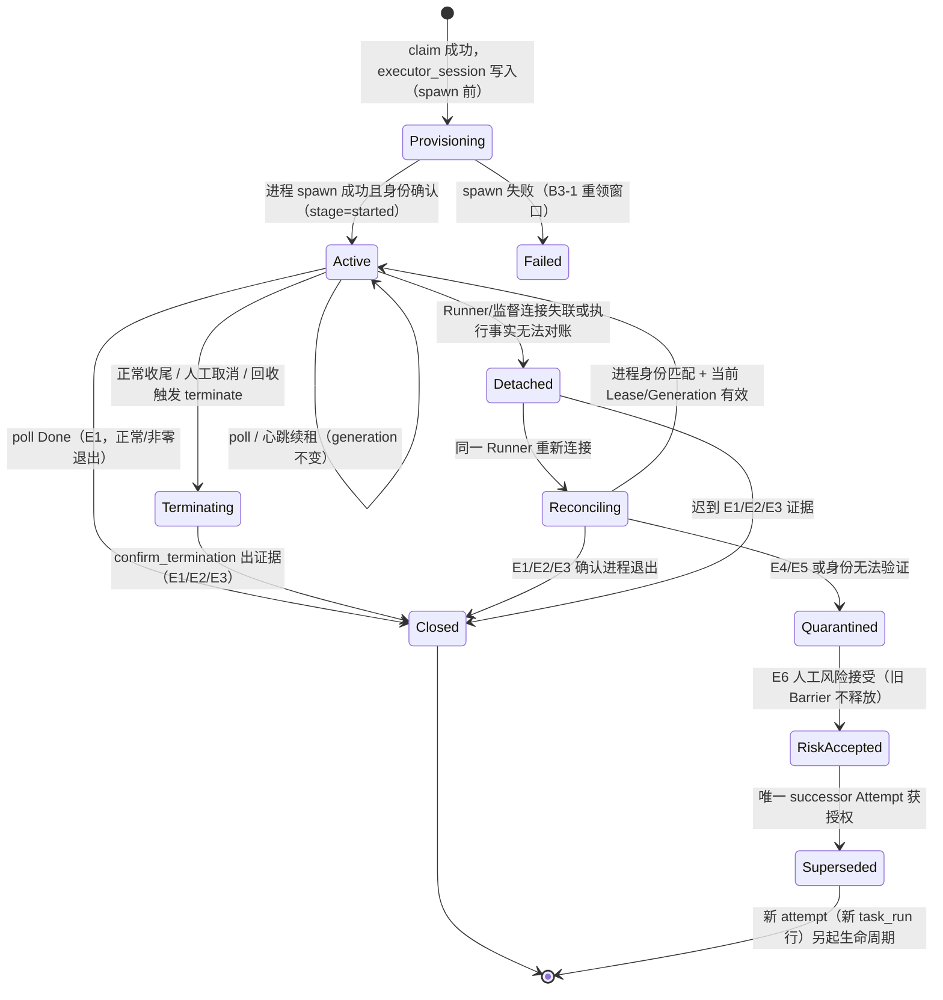

# Session Manager 设计（session-manager-design）

- 性质：架构设计（Phase 3 的设计依据），本阶段不实施。
- 定位：Session Manager 是**逻辑职责模块**，不是微服务、不是新进程。落在 `crates/pm-application`（新增 `session_manager` 模块），实现落 `pm-infrastructure::codex_executor`。

## 1. 概念分层（六个 ID，一个都不混用）

| 概念 | 现状载体 | 生命周期归属 | 权威源 |
|---|---|---|---|
| **Run** | `delivery.task_run.id`（业务执行单） | 平台业务 | PostgreSQL |
| **Execution / Attempt** | 同一张表：`attempt_no` + `supersedes_run_id`——**一个业务 Run 概念由多条 task_run 行表达**（Greenfield 结论：不新增 execution 表，现状模型已足够） | 平台业务 | PostgreSQL |
| **Executor Session（进程身份）** | `task_run.executor_session`（`{kind}:{uuid}`，spawn 前写入） | SEM 宿主机进程 | PostgreSQL（声明）+ 宿主机 pid 文件（事实） |
| **Runner Process Session** | `lease_owner = client:{device_id}` + Runner 本地 process identity（目标通过 WSS 上报） | 用户设备 | Platform Lease + Runner OS process evidence |
| **Harness Native Session** | **当前未采集**（SEM-01 ❌ 结论，复核确认） | Harness（codex rollout 等） | 本设计新增采集（§4） |
| **平台 Session（生命周期聚合）** | 不存在——**本设计将其定义为「上述事实的投影视图」而非新实体** | — | PostgreSQL |

**原则**：不把 `executor_session` 升级为 Harness Native Session ID（任务明令）。二者语义不同：前者是「我们 spawn 的进程身份」，后者是「Harness 自己的会话标识（如 codex rollout id）」。

## 2. Session 生命周期状态机



- 状态是 `task_run` 行 + `run_events` 的**投影**，不新建表存状态（Greenfield 审慎原则：现有 `stage`/`status`/`run_events`/审计已覆盖状态迁移记录）。
- `Provisioning→Active` 边界即现有 `stage: dispatch → started` 语义；`Detached` 是 Phase 0 证据模型引入的新语义（挂起态，配合 scheduling shield）。

## 3. 模块边界（`pm-application::session_manager`）

```
pm-application/src/session_manager/
├── mod.rs        # 会话生命周期接口 + 状态推导（读 task_run/stage/run_events 投影）
├── ports.rs      # SessionProbe / SessionResume 端口（trait）
├── lifecycle.rs  # Provisioning/Active/Detached/Terminating/Closed 迁移判定（纯函数）
└── handoff.rs    # 跨执行端接管的状态前置校验（与 runner-supervision 文档对应）
pm-infrastructure/src/codex_executor.rs
└── impl SessionProbe / SessionResume for CodexExecutor   # pid 文件/三证据/rollout 采集
```

- 复用现有接口：`RunExecutor` trait（start/poll/terminate）不动；`confirm_termination` 是 Phase 0 新增端口，Session Manager 直接消费其证据。
- Session Manager **不拥有进程**——进程归 CodexExecutor / Runner；它只拥有「生命周期的记账与仲裁」。

## 4. Harness Native Session ID 采集与恢复

### 4.1 采集

- Native Session ID 必须由**实际运行 Harness 的执行主机**采集：SEM-local CodexExecutor 在 SEM 主机采集；Client Runner 在用户设备采集并通过 WSS 上报 Platform。SEM 的 `poll_active_runs` 不能读取远端 Runner 的 CODEX_HOME，也不能作为远程 Runner Session ID 的采集点。
- **Greenfield Schema 增量（最小）**：`delivery.task_run` 加两列：
  - `harness_session_id text NULL` — Harness 原生会话标识；
  - `harness_kind text NULL` — 采集来源（`codex` / `zcode` / …），与 `executor_id`/客户端名对齐。
  不建新表、不建「六字段全家桶」（任务明示不要机械新增）；`platform_session_id`（=task_run.id）、`execution_id`/`attempt_id`（=task_run.id+attempt_no）、`executor_session_id`（=executor_session）、`runner_process_id`（=lease_owner/pid 文件）**全部已存在**，只是名字不同——本设计以映射表（§1）代替新列。

### 4.2 Harness Adapter 能力声明

```rust
pub struct HarnessCapabilities {
    pub supports_native_session_id: bool,    // 能否采集原生 session id
    pub supports_resume: bool,               // 能否以 native session id 恢复
    pub supports_session_inspection: bool,   // 能否查询会话状态/回放
    pub supports_process_termination: bool,  // 能否可靠终止进程
    pub supports_activity_events: bool,      // 能否产出活动事件流
}
```

- 能力表**在代码中**（每 harness 一份 const），不进 DB——能力是编译期事实，不是运行时数据。
- 初版：codex = `{native_session_id: true, resume: 待验证(默认 false), inspection: false, termination: true, activity_events: true}`；其余 harness 全 false 直到验证。
- `supports_resume=false` 的 harness：恢复语义退化为「新 Attempt」，绝不假装续会话。

### 4.3 恢复判定（Session 能否恢复）

```
HIR/重派时：
  harness capabilities.supports_resume
  AND harness_session_id IS NOT NULL
  AND 原执行端可访问（Runner 设备/SEM 主机在线）
  AND 所需原生 Session 元数据仍可取得
  AND 原执行权已安全终止（E1/E2/E3 证据）
  → Resume：仅在原执行端仍可访问、Harness 原生会话元数据可用且目标版本实测通过时，恢复原 Harness Session；新 Attempt 不得仅凭复制 session id 就假设可跨设备/主机恢复
否则 → Fresh Attempt：新 task_run 行，supersedes_run_id 链保留血缘，HIR 关联记录
```

## 5. Session 事件持久化

- **PostgreSQL 是生命周期权威**：状态迁移走现有 `run_events` + 审计（`reclaim_task_run`、`run.orphan_suspected` 等已有 action 复用，新增 `session.detached` / `session.resumed` 两个 action）。
- **宿主机文件系统是执行证据**：executor-events.jsonl、pid 文件、日志——只读参考，不作状态判定权威（除 E2 进程检查外，检查结论仍落 DB）。
- 不引入任何外部状态存储（任务禁令）。

## 6. Worker 重启后的恢复策略

1. 启动时 `reconcile_orphans`（现状保留）。
2. Session Manager 投影重建：扫 `status IN ('claimed','running')` 的 task_run → 按 pid 文件（卷持久化后仍在）+ `confirm_termination` 分类：E1/E2 → 走回收（证据前置后的 `recover_lost_run`）；E4/E5 → `Detached`（挂起 + 告警 + HIR）。
3. children map 是内存态，重启即空——运行期持久卷中的 pid 文件是同主机重启后的辅助进程锚点；卷仅要求运行期持久化，不做备份。若卷丢失，不能把 PID 证据缺失解释为进程死亡，相关 Run 进入 E4/E5 并隔离。
4. Runner 侧（用户设备）重启：现有 `recover_inflight_run` 主要覆盖 `start_wait` + responded Interaction 的 continuation，不覆盖执行中途失联。目标必须增加同设备 `Detached → Reconciling → Active/Terminated/Quarantined`，由 WSS reconnect sync + boot/process identity + Platform Lease/Generation 对账完成；不能声称平台侧无需变更。

## 7. 与 Run / Execution / Attempt 的关系（任务 §五 3）

- 一个业务执行 = task_run 行链（attempt 1 → 2 → …，`supersedes_run_id` 血缘）。
- 一个 Attempt = 一个 task_run 行 = **至多一个** Executor Session + **至多一个** Harness Native Session。
- Session 生命周期 ⊂ Attempt 生命周期：Attempt 终态后 Session 必为 Closed/Superseded（终态僵尸由 `cleanup_finished_processes` 兜底 terminate，现状保留）。
- Native Resume 成功时：新 Attempt 行携带 `harness_session_id`，与旧 Attempt 通过 `supersedes_run_id` + HIR 关联——Session 只有在同一执行主机、同一 CODEX_HOME 且能力实测通过时才可能延续；**执行权（租约/generation）绝不跨行延续**。普通 Interaction continue 是 checkpoint/reply 注入 + Fresh Session，不是 Native Resume。


## 8. 三种连续性能力必须分开（Review Pending）

1. **Interaction Continuation**：checkpoint + 用户回复注入后创建新的 Agent 进程/Session。它是当前已有的 continue 语义，不是原生 Session Resume。
2. **Process Reattachment**：Runner Supervisor 重启后，若同一 OS boot 下原进程仍活着、进程身份精确匹配、Lease/Generation 仍有效，重新建立进程监督句柄。若旧进程被 Job Object/启动清理终止，必须先上报 E3，再走 continuation/recovery。
3. **Harness Native Resume**：通过 Harness 自身原生 session ID 恢复。Codex resume 默认 false；必须在同一执行主机、同一 CODEX_HOME、原生元数据可用且精确版本验收通过后才启用。跨设备不能只复制 session ID。

Runner 本地的 CODEX_HOME 与 rollout 元数据属于该设备本地状态；SEM 不能在另一台主机凭一个 ID 恢复。Session ID 应由执行主机采集并通过控制通道上报。新 Attempt 的 checkpoint/reply 注入仍然可用，但必须明确标为 Fresh Session。

## 9. Lost 与 Detached 的安全语义

- `ExitOutcome::Lost` 不等于退出确认。若 Run 曾到 `stage='started'`，PID 文件、日志或 Workspace root 丢失必须降级 E5/Uncertain。
- Detached 不加入 Interaction scheduling_shield 四值；由 Execution lifecycle 投影 + `run_execution_barrier` 表达。
- Runner 重启恢复必须检查 boot_id、process creation identity、lease_client_id、generation、lease validity；不确定则 HIR。

完整修正见 [评审问题核验与修正设计](./sem-02d-review-findings-corrective-design.md)。
