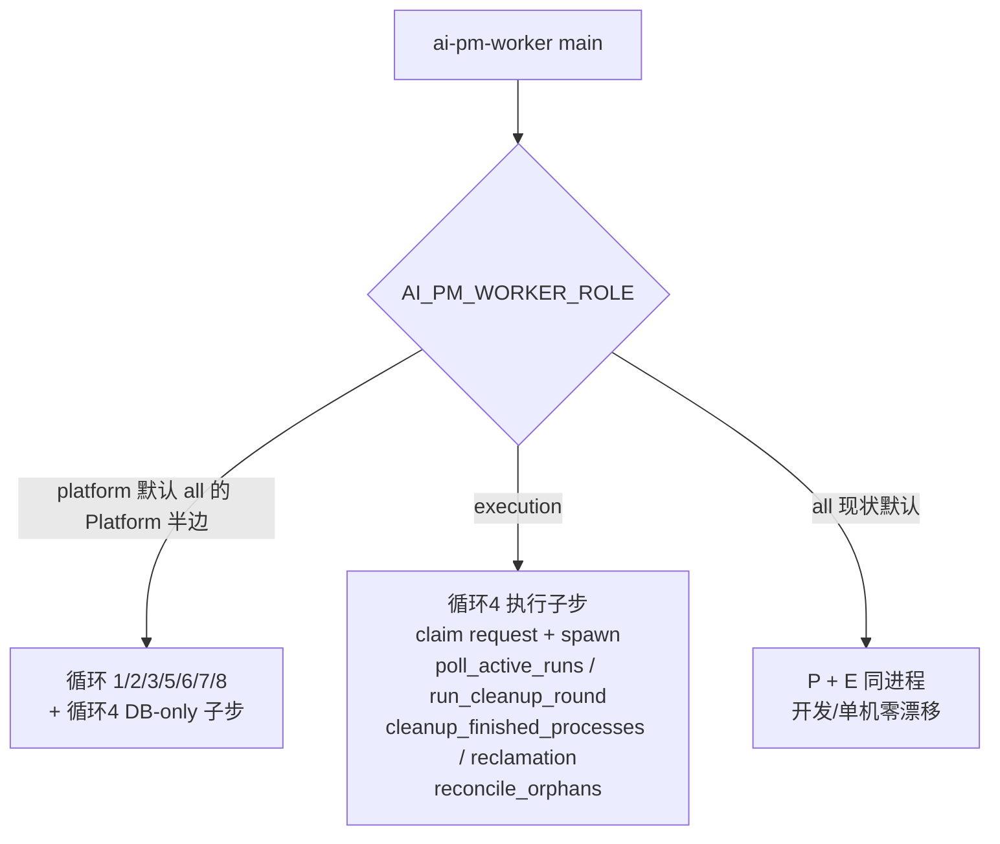
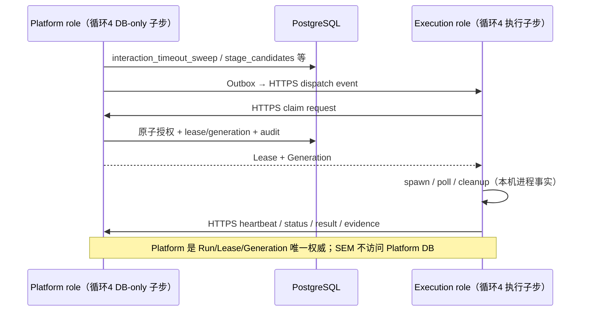

# Worker 角色拆分（worker-role-separation）

- 性质：架构设计（Phase 1 的设计依据），本阶段不实施。
- 前提：Greenfield 政策允许直接重构装配代码，不留兼容开关以外的过渡层。

## 1. 循环归属总表

### 1.1 ai-pm-worker 的 8 条循环

| 循环 | 内容 | DB | 进程 | FS | 常驻 | 归属 | 理由 |
|---|---|---|---|---|---|---|---|
| 1 | ai_analysis | ✅ | ❌ | ❌ | ✅ | **Platform** | 只调 LLM API |
| 2 | repo_import | ✅ | ❌ | ❌（knowledge Git 卷由 Platform 侧服务持有） | ✅ | **Platform** | 依赖 Platform 的仓库卷 |
| 3 | outbox 分发 | ✅ | ❌ | ❌ | ✅ | **Platform（唯一消费者）** | 见 §3 D2 |
| 4 | Run 调度与执行 | ✅ | ✅ | ✅（workspace/pid/日志/事件） | ✅ | **拆分**：执行子步→SEM，DB-only 子步→Platform | 见 §2 |
| 5 | review 领取拍 | ✅ | ❌ | ❌ | ✅ | **Platform** | 确定性校验管线，纯 DB+LLM |
| 6 | 失败判定作业 | ✅ | ❌ | ❌ | ✅ | **Platform** | 扫描谓词纯 DB |
| 7 | 会话回复（Batch G） | ✅ | ❌ | ❌ | ✅ | **Platform** | LLM 生产者 |
| 8 | 访谈编排（DK-B） | ✅ | ❌ | ❌ | ✅ | **Platform** | 编排逻辑 |

### 1.2 循环 4 子步拆分

| 子步 | 归属 | 理由 |
|---|---|---|
| `claim_and_start` 的执行半边（向 Platform API 请求 claim；成功后 spawn 本机进程） | **SEM** | spawn 与工作区/pid 必须**同主机**（SEM-01 结论 10） |
| `poll_active_runs`（本机进程三证据 poll；Run 状态/Lease 查询与结果写入经 Platform API） | **SEM** | 本机进程事实必须在 SEM 主机采集；业务状态仍由 Platform 权威维护 |
| `run_cleanup_round`（收尾/失败处理；业务状态变更经 Platform API） | **SEM** | 需访问本地进程证据；不直接写 Platform DB |
| `cleanup_finished_processes`（终态僵尸兜底 terminate） | **SEM** | terminate 必须在本机 |
| workspace reclamation 物理执行 | **SEM** | 删文件必须在工作区卷所在主机 |
| `interaction_timeout_sweep`（会话超时扫描） | **Platform** | 纯 DB |
| `comm_overview`（统计） | **Platform** | 纯 DB |
| `stage_candidates`（候选整理） | **Platform** | 纯 DB |
| `reconcile_orphans` | **SEM** | 通过 Platform API 获取待核对 Run、在 SEM 主机验证进程证据，再经 API 提交证据/恢复请求；见 `execution-safety.md` §3.2 |

### 1.3 其他进程

| 进程 | 归属 | 备注 |
|---|---|---|
| `pm-api`（含 audit LISTEN listener） | **Platform** | listener 是 pm-api 进程内 SSE 推送（`main.rs:36-41`），非独立循环 |
| `pm-worker`（repo-import / mcp-inbox，2 条 spawn） | **Platform** | `register_all_handlers` 全集装配（`main.rs:39`） |
| `ai-pm-runner` | **Client Runner** | 永不被 SEM 当本地子进程管理 |

## 2. 角色化装配（`AI_PM_WORKER_ROLE`）

- 取值：`platform` | `execution` | `all`（**默认 `all`**——单机开发/部署零行为漂移，独立主机部署时显式设值）。
- **角色装配本身**可集中在 `apps/ai-pm-worker/src/main.rs`；但 Platform–SEM 独立 DB/API 边界不是单文件改动。当前 `run_executor`、`claim`、`worker_command`、执行事件和 `CodexExecutor` 等路径直接依赖 Platform `PgPool`，必须抽取应用层 ports，并分别提供 Platform SQL adapter 与 SEM HTTPS client adapter。禁止把这项服务边界重构误估为只改 main.rs。
- Greenfield 允许把循环 4 拆成两个显式函数（`run_db_only_round` / `run_execution_round`）再按角色装配，不保留「一个循环内部 if 角色」的纠缠写法。
- **不拆新二进制**（Phase 1）；常态化后可选派生 `apps/ai-pm-execution-worker`（复用 pm-application/pm-infrastructure，零新依赖）——属 Phase 2 之后的可选项，非必需。

## 3. Outbox 单消费者约束（D2）

- **约束**：循环 3 在整个系统中**至多一个部署单元运行**（定 Platform 角色）。SEM 角色不装配 outbox worker、不调用 `register_all_handlers`。
- 为什么这就够了：`register_all_handlers` 装配集合 = `EventCatalog` 全集（`outbox.rs:394` 的编译期/启动期校验）。只要消费者唯一，不存在「A 进程注册了事件 X、B 进程没注册 → X 永久 pending/假死信」的分叉面。
- guard：SEM 角色启动时若检测到 outbox 循环被请求装配 → 启动失败（fail-fast），防误配。
- 投递语义不变：outbox 仍是 Platform 内的 DB 轮询分发，SEM 与 Platform 之间通过版本化 HTTPS API 通信；Platform Outbox 负责可靠触发，双方不共享 PostgreSQL。

## 4. 循环 4 的跨角色协作

拆分后循环 4 的 Platform 业务半边与 SEM 执行半边通过版本化 HTTPS API 协作；不共享数据库、不直接读写对方数据：

- `AI_PM_RUN_DISPATCH` 在 SEM 执行角色门控本地调度，不代表 SEM 可直接写 Platform DB。
- Platform 只在 API 内完成 claim、Lease、Generation 和业务状态事务；SEM 只请求 claim 并在成功后启动进程。
- 无人监督 Runner 的自动选择由 SEM Scheduler 按 Platform 授权策略和 Runner 能力执行；supervised 仍须用户确认。

## 5. 角色化后的重复执行风险矩阵

| 风险 | 缓解 |
|---|---|
| 两个角色同时跑 outbox | §3 单消费者约束 + SEM fail-fast |
| 两个 execution 实例领同一 Run | Platform claim API 内的事务锁/并发仲裁 + Generation fencing |
| Platform 与 SEM 对 Run 状态形成双写 | Platform API 是唯一写入口；SEM 无 Platform DB 凭据 |
| B06-D3 被 Platform/Execution 双跑 | 定 SEM 单点；audit `run.orphan_reclaimed` 去重保留为第二道防线（现状已有 NOT EXISTS 去重） |
| workspace reclamation 双跑 | 只装配在 Execution；三重开关不变 |
